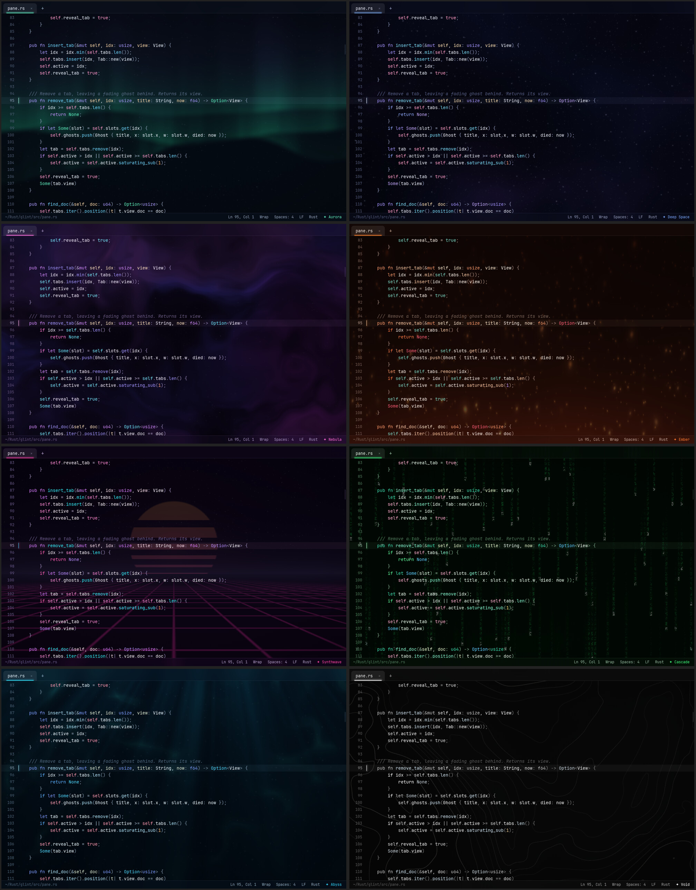
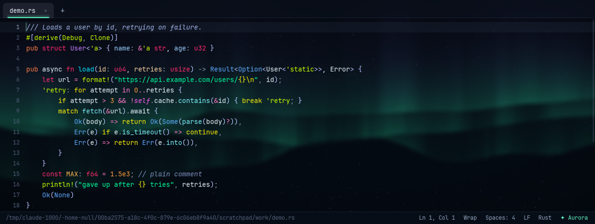
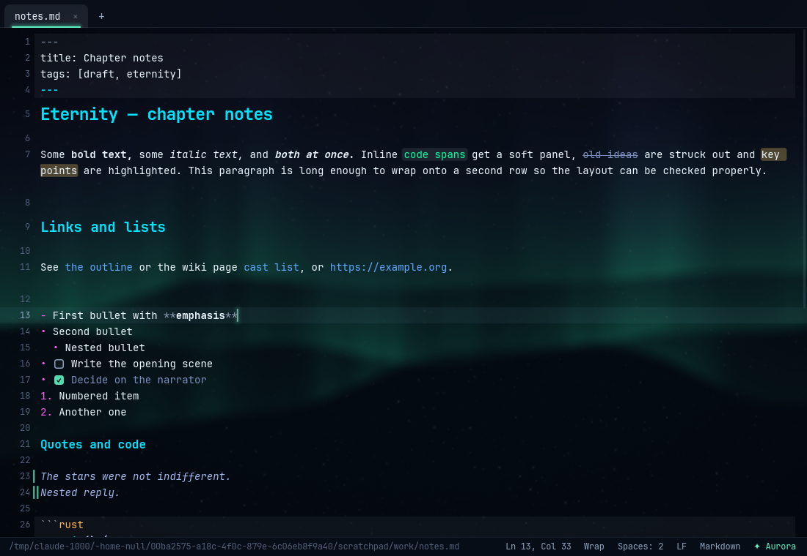

# Glint

A small, pretty text editor written in Rust. Custom GPU renderer (wgpu), animated
shader backgrounds, very dark themes with bright text, and tabs that survive
restarts — including unsaved drafts.







## Features

- **Tabs and splits** — tabs per pane, drag to reorder or drop onto another pane,
  split right / down, draggable dividers.
- **Hot exit** — closing the window never asks anything. Tabs, cursors, scroll
  positions, splits and unsaved text all come back next launch. If a file changed
  on disk since its draft was written, the disk version wins.
- **Syntax highlighting** picked from the file name or first line (about 200
  languages via syntect), highlighted incrementally so big files stay responsive.
- **Soft word wrap** with hanging indent, smooth scrolling, gliding caret.
- **Multiple cursors** — Ctrl+click to add one, Ctrl+D to select the next
  occurrence, Ctrl+Shift+L for all of them, Alt+Shift+Up/Down to add a cursor
  on the next row, Alt+drag for a column. Typing, deleting, moving, copy and
  paste work at every cursor, and each edit is a single undo step.
- **Bracket help** — brackets and quotes close themselves, wrap a selection,
  step over an existing closer and delete as a pair; the bracket matching the
  one at the caret is outlined. Indent guides and a current-line highlight.
- **Find / replace** with case, whole-word and regex modes (`$1` captures work).
- **Command palette**, go to line, language picker.
- **File finder** (Ctrl+P) — one box for open tabs, recent files, the current
  file's neighbours, folders you have used before and an index of your home
  folder. Type a name (`app`), a folder then a name (`glint/ app`), or a path
  to browse (`~/`, `../`). Tab jumps into the highlighted folder, or into the
  folder of the highlighted file. It remembers what you pick for a query. Network and
  FUSE mounts (a phone, a cloud drive) stay out of the index; browse into
  them by path instead.
- **Word count** in the status bar for Markdown and plain text (and for any
  selection).
- **Eight themes**, each with its own animated background and adjustable knobs:
  Aurora, Deep Space, Nebula, Ember, Synthwave, Cascade, Abyss, Void. The
  background answers typing with a ripple from the caret ("React to typing"
  in settings; 0 turns it off).
- **Markdown live preview** — `.md` files are shown rendered (headings, bold,
  italic, links, wiki links, inline code, lists, task checkboxes you can click,
  quotes, rules, highlights, strikethrough, front matter) and the line under the
  caret or selection turns back into raw Markdown for editing. Code blocks stay
  raw. Ctrl+Shift+M switches the preview off and on.
- **Syntax palettes** chosen separately from the theme: Cyberpunk (default),
  Outrun, Candy, Ice, or "Match theme". 37 token colours, including control
  flow, calls, built-ins, modifiers, lifetimes/labels, brackets and doc comments.
- **Settings panel** (Ctrl+,) with live sliders for font, background intensity,
  speed, scale, per-scene knobs, dimming behind text, frame rate and quality.

## Build and run

```bash
cargo run --release -- [files...]
```

`./install.sh` builds a release binary and installs it to `~/.local/bin/glint`
with a desktop entry and icon (`./install.sh --uninstall` removes them).

Needs a Vulkan (or GL) capable GPU. Tested on Linux / Wayland (KDE Plasma).

## Keys

| | |
|---|---|
| Ctrl+N or Ctrl+T / Ctrl+O / Ctrl+S / Ctrl+Shift+S | new tab / open / save / save as |
| Ctrl+W, Ctrl+Shift+W | close tab, reopen closed tab |
| Ctrl+Tab, Ctrl+Shift+Tab, Alt+1…9 | switch tabs |
| Ctrl+\\, Ctrl+Shift+\\ | split right, split down |
| Ctrl+Alt+Arrows, F6 | move focus between panes |
| Ctrl+F, Ctrl+H, F3 / Shift+F3 | find, replace, next / previous |
| Ctrl+G | go to line (`120` or `120:8`) |
| Ctrl+Shift+P or F1 | command palette |
| Ctrl+P | file finder (tabs, recent, neighbours, folders, home index) |
| Ctrl+Shift+T | theme picker (live preview) |
| Ctrl+Shift+C | syntax colour picker (live preview) |
| Ctrl+, | settings |
| Ctrl+D, Ctrl+Shift+L | select next / all occurrences (adds cursors) |
| Ctrl+click, Alt+Shift+Up / Down, Alt+drag | add a cursor, add one above / below, column selection |
| Esc | back to one cursor, then drop the selection |
| Alt+Up / Alt+Down, Ctrl+Shift+K | move, delete line |
| Ctrl+/ | toggle comment |
| Ctrl+= / Ctrl+- / Ctrl+0, Ctrl+wheel | zoom |
| Alt+Z | toggle word wrap |
| Ctrl+Shift+M | toggle Markdown preview |
| F11 | fullscreen |

Closing an unsaved tab asks once; **Don't Save** is the default, so `Ctrl+W`
then `Enter` — or `Ctrl+W` twice — closes it without saving. A held key never
answers the prompt, and a discarded draft can still be brought back with
`Ctrl+Shift+W` until you quit.

## Files

| | |
|---|---|
| `~/.config/glint/config.toml` | settings (written by the settings panel) |
| `~/.config/glint/themes/*.toml` | your own themes; same format as `assets/themes/` |
| `~/.config/glint/syntax/*.toml` | your own syntax palettes; same format as `assets/syntax/` |
| `~/.local/share/glint/session.json` | open tabs and layout |
| `~/.local/share/glint/drafts/` | unsaved text |
| `~/.local/share/glint/files.json` | what the file finder has learned |

Run "Open Config Folder" from the palette to get there; it also drops an
example theme you can copy. A theme sets UI colours, syntax colours and a
background (`kind`, `intensity`, `speed`, `scale`, four colours and the
scene's knobs).

## Performance notes

The background is rendered into a low-resolution texture at a capped frame
rate (30 fps by default) and pauses when the window loses focus. Text is only
re-laid-out when it changes; a frame where just the background moves is one
blit. Lower "Quality" or "Frame rate" in settings on weak GPUs, or turn
"Animate" off for a static backdrop.

## Development

`GLINT_HOME=/some/dir` relocates config, session and the single-instance socket,
so a test run never touches your real session. Snapshot runs only read or write
a session and config when `GLINT_HOME` is set.

There is a headless snapshot mode that drives the real app and renders a PNG:

```bash
GLINT_HOME=/tmp/glint-test target/debug/glint --no-session --snapshot out.png \
  --size 1400x860 --do "key:ctrl+shift+p; type:split; wait:0.3" src/main.rs
```

Script steps: `key:`, `type:`, `click:x,y`, `dclick:`, `drag:x1,y1,x2,y2`,
`wheel:x,y,dy`, `wait:secs`, `shot:file.png`, `dialog:path`, `open:path`,
`resize:WxH`, `focus:0|1`. Clicks and drags take a trailing modifier
(`click:240,101,ctrl`, `drag:120,120,200,210,alt`). The final image is taken
after animations settle; use `shot:` for anything mid-animation.
`GLINT_INDEX_ROOT=/some/dir` points the file finder's index at another folder.

Layout of the code: `app.rs` (state, commands, input), `draw.rs` (scene
building), `editor.rs` (text view), `pane.rs` (tabs, split tree), `overlay.rs`
(palette, settings, confirm), `find.rs`, `buffer.rs` (rope + undo), `wrap.rs`,
`highlight.rs`, `md.rs` (Markdown preview), `pairs.rs` (brackets), `files.rs`
(file finder), `gfx.rs` + `shaders/` (renderer), `runner.rs` (window, events).

Fonts: JetBrains Mono (SIL Open Font License, see `assets/fonts/OFL.txt`).
